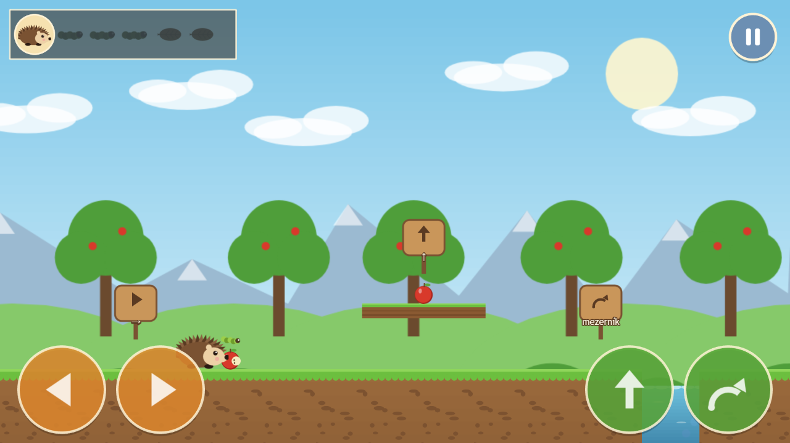

# 🦔 Ježek a jablíčko

Naučná 2D skákačka pro malé děti (3–5 let). Ježek hledá jablka, sní z nich jen červíka (housenku)
a jablko vtipně vyprskne. Pak nanosí listí do úkrytu a uloží se k zimnímu spánku.
Hra běží v prohlížeči, později i na Android telefonech a tabletech.

**Hrát online:** https://programos1.github.io/hedgehog-and-the-apple/
**Stav vývoje:** [STAV_PROJEKTU.md](STAV_PROJEKTU.md) · **Herní design:** [docs/02_herni_design.md](docs/02_herni_design.md)



## Ovládání

Vždycky jen **jedno tlačítko najednou**. Skáče se jen ze stoje, a když ježek zrovna jde, sám zastaví a skočí.

| Akce | Klávesnice | Dotyk |
|---|---|---|
| Jdi doleva / doprava | `←` `→` (nebo `A` `D`) | oranžová tlačítka vlevo |
| Skok nahoru | `↑` (nebo `W`) | zelené tlačítko se šipkou nahoru |
| Skok dopředu | `mezerník` | zelené tlačítko s obloukem |
| Pauza | `Esc` / `P` | modré tlačítko vpravo nahoře |

Jablka i listí se sbírají automaticky dotykem. Z vody se ježek vrátí na poslední bezpečné místo, prohrát se nedá.

## Spuštění na počítači (pro vývojáře)

Potřebuješ [Node.js](https://nodejs.org) 20 nebo novější.

```
npm install        # jednou, stáhne knihovny
npm run dev        # spustí hru, otevři http://localhost:5173
npm run build      # vytvoří hotovou verzi do složky dist/
```

- **Na tabletu nebo telefonu ve stejné Wi-Fi:** `npm run dev` vypíše i adresu `Network: http://192.168…:5173`. Tu otevři v prohlížeči tabletu.
- `?touch=1` v adrese zapne dotyková tlačítka i na počítači, `?debug` zobrazí fyzikální obrysy.
- Po naklonování zapni hooky pro stav projektu: `git config core.hooksPath .githooks`
- Každý push do `main` hru automaticky nasadí na GitHub Pages.

## Struktura

```
src/
  config.ts          rozměry, rychlost chůze, výška a délka skoků
  levels/            data levelů (level1–3.ts)
  entities/          ježek (pohyb, skoky, animace)
  scenes/            Boot, Menu, Game, Hud, Pause, LevelComplete
  input/Controls.ts  klávesnice + dotyk → stejné akce
  audio/             zvuky a hudba (se zástupnými tóny)
  art/               zástupná grafika kreslená kódem
  assets/manifest.ts sem se zapisuje skutečná grafika a zvuk
  data/              texty a zajímavosti o ježcích
docs/                zadání, design, grafika (ASSETS.md), snímky obrazovky
```

Jak vyměnit grafiku a zvuky: [docs/ASSETS.md](docs/ASSETS.md)

## Autorská práva
© 2026 Tomáš Horák. Všechna práva vyhrazena. Repozitář je veřejný pouze ke čtení, podrobnosti v souboru [LICENSE](LICENSE).
